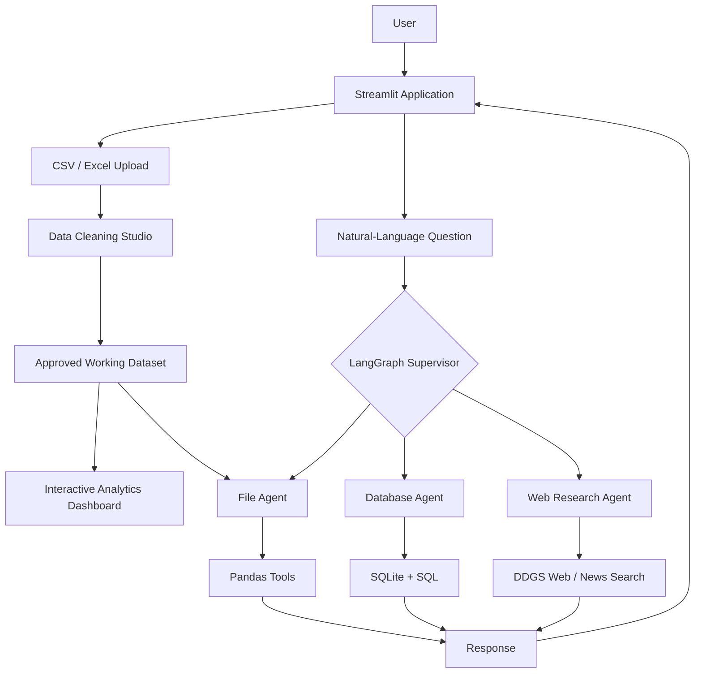

# AI Data Analyst Agent

**A multi-agent business analytics application built with LangGraph, Google Gemini, Streamlit, Pandas, Plotly, and SQLite.**

The AI Data Analyst Agent lets users explore CSV/Excel data through an interactive dashboard and natural-language questions. A LangGraph-based supervisor routes queries to specialized agents for file analysis, database analysis, or web research. An integrated Data Cleaning Studio supports human-approved transformations and data-quality validation.

> **Project status:** Locally developed and tested. This repository contains the source code; public cloud deployment is not yet claimed.

## Features

- **Natural-language analysis:** Ask questions about sales, profits, quantities, margins, products, regions, and monthly performance.
- **Multi-agent routing:** A LangGraph supervisor selects the File Agent, Database Agent, or Web Research Agent based on the request.
- **File Agent:** Uses Pandas-based tools to calculate results from uploaded CSV and Excel files.
- **Database Agent:** Runs SQL analysis on SQLite data, including aggregation and ranking queries.
- **Web Research Agent:** Uses DDGS to retrieve external web/news results with available source links.
- **Interactive dashboard:** KPIs, charts, filters, and locally calculated business insights using Streamlit and Plotly.
- **Data Cleaning Studio:** Profiles data, handles missing values and duplicates, standardizes formats, detects outliers, validates business rules, and exports cleaned data.
- **Human-in-the-loop cleaning:** The original data is preserved; transformations are applied to a working copy only after user approval.
- **Auditability:** Records applied transformations and provides a downloadable data-quality JSON report.

## System Architecture



The **supervisor handles agent routing**. **Gemini supports natural-language understanding and tool use**, while **Pandas and SQL execute the numerical calculations**; the language model is not the source of business metric values.

## Technology Stack

| Layer | Technology |
|---|---|
| Programming | Python |
| User interface | Streamlit |
| Data processing | Pandas, NumPy |
| Visualizations | Plotly |
| LLM | Google Gemini (`google-genai`) |
| Agent orchestration | LangGraph |
| Database | SQLite |
| Web and news search | DDGS |
| Data preparation | Custom Python cleaning and validation modules |

## Project Structure

```text
AI_Data_Analyst_Agent/
├── agents/
│   ├── file_agent.py
│   ├── database_agent.py
│   ├── web_agent.py
│   ├── supervisor.py
│   └── synthesizer.py
├── api/
│   └── main.py
├── app/
│   ├── app.py
│   └── data_cleaning_studio.py
├── cleaning/
│   ├── cleaning_engine.py
│   ├── data_profiler.py
│   ├── missing_handler.py
│   ├── duplicate_detector.py
│   ├── standardizer.py
│   ├── outlier_detector.py
│   ├── business_validator.py
│   └── audit_report.py
├── data/
│   └── sample/
│       ├── sample.csv
│       └── messy_sales_test.csv
├── database/
│   └── schema.sql
├── prompts/
├── tools/
│   ├── analysis_tools.py
│   ├── file_tools.py
│   ├── mysql_tools.py
│   └── web_tools.py
├── utils/
├── workflows/
│   └── analyst_graph.py
├── test_*.py
├── requirements.txt
├── .gitignore
└── README.md
```

> **Note:** `tools/mysql_tools.py` is the existing filename of the database utility module; the implemented database agent uses SQLite.

## Getting Started

### 1. Clone the repository

```bash
git clone https://github.com/shivashakthimanivannan-droid/AI_Data_Analyst_Agent.git
cd AI_Data_Analyst_Agent
```

### 2. Create and activate a virtual environment

**Windows PowerShell:**

```powershell
python -m venv venv
.\venv\Scripts\Activate.ps1
```

**macOS / Linux:**

```bash
python3 -m venv venv
source venv/bin/activate
```

### 3. Install dependencies

```bash
python -m pip install -r requirements.txt
```

### 4. Configure Gemini credentials

Create a `.env` file at the project root and set the Gemini API key using the variable name expected by your `utils/config.py` and agent configuration. For example, **if the project reads `GEMINI_API_KEY`**:

```dotenv
GEMINI_API_KEY=your_gemini_api_key_here
```

**Never commit `.env` or publish real API keys.** The exact key name should be verified against the local configuration before running the app.

### 5. Run locally

```bash
streamlit run app/app.py
```

Open the local URL displayed by Streamlit (usually `http://localhost:8501`).

## How to Use

1. Upload a CSV or Excel dataset using the sidebar.
2. Map the date, region, product, sales, profit, and quantity columns where available.
3. Optionally open **Data Cleaning Studio** to review issues, approve cleaning operations, and select the working dataset.
4. Explore dashboard KPIs, filters, business insights, and visualizations.
5. Ask questions in natural language. The supervisor routes each question to the appropriate agent.
6. Download the cleaned CSV and data-quality JSON report when required.

### Example Questions

**File analysis**

- Which product generates the highest profit?
- What is the total sales revenue?
- Which region has the highest sales?
- What is the overall profit margin?

**Database analysis**

- Which region has the highest profit in the database?
- Which product has the lowest profit in the database?
- Show sales by region from the database.

**Web research**

- What are recent trends in AI for business analytics?
- Find recent news about data analytics.

## Verified Sample Results

The locally tested **12-record sample sales dataset** produced:

| Metric | Result |
|---|---:|
| Total sales | 1,454,000 |
| Total profit | 281,000 |
| Total quantity | 227 |
| Profit margin | 19.33% |
| Highest-profit product | Laptop (157,000) |
| Highest-profit region | North (75,000) |
| Highest-sales region | North (378,000) |

These figures are **demonstration data**, not production business results.

## Data Cleaning and Validation

The Data Cleaning Studio supports:

- Dataset profiling and completeness checks
- Missing-value treatment (including preserving unknown numeric values as missing)
- Exact duplicate removal
- Text, category, numeric, and date standardization
- Statistical outlier review
- Required-field and numeric-range validation
- Financial validation for records where Profit exceeds Sales
- Before/after comparison, audit logging, and exports

A deliberately messy **7-record** test dataset was used to validate the workflow. After approved duplicate removal, the working copy contained **6 records and 0 exact duplicates**. Validation identified **1 negative Quantity record** and **1 record with Profit greater than Sales**. An unresolved missing numeric Sales value was retained for review rather than silently replaced with zero.

**Data cleaning requires human approval.** Flagged records are not automatically corrected because their business meaning may need investigation.

## Testing

The project was exercised locally through individual agent/module tests and Streamlit integration:

- File Agent: sample dataset questions and computed metrics
- Database Agent: 10 analytical test queries with expected results
- Supervisor: routing tests across the three agent categories
- Web Agent: web/news retrieval and source-link display (quality and freshness depend on external results)
- Dashboard: KPI calculations, charts, and filtering
- Cleaning Studio: duplicate removal, missing-value handling, validation, and audit workflow

Several `test_*.py` scripts are included in the repository. This is a locally tested prototype; these results are **not** a claim of comprehensive production testing.

## Known Limitations

- SQLite data used locally may require initialization or population in a new environment; local `.db` files are excluded from Git.
- Database analysis does not automatically guarantee synchronization with every change to a cleaned, uploaded dataset.
- Web results depend on search-provider availability; publication dates and relevance require verification.
- Incorrect source data can produce misleading results even if calculations are performed correctly.
- Human approval and additional checks are needed for sensitive or high-stakes business decisions.

## Future Improvements

- Public application deployment and environment-specific configuration
- Configurable external database connections
- Broader dataset/schema compatibility
- Automated regression and agent-response evaluations
- More data-quality rules, logging, and monitoring

## Repository

[GitHub — AI Data Analyst Agent](https://github.com/shivashakthimanivannan-droid/AI_Data_Analyst_Agent)

## License

No open-source license has been added yet. All rights are reserved unless a license is added to this repository.
